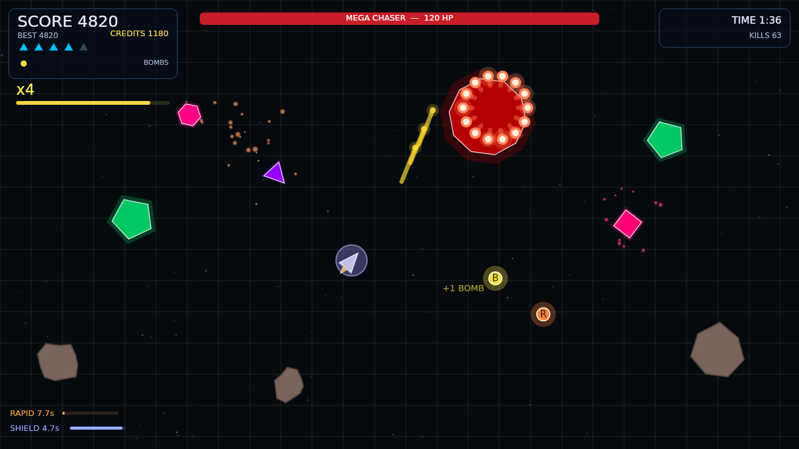

# GeoStrike Evolved

A fast, arcade-style survival shooter built with [p5.js](https://p5js.org/).
You pilot a triangular ship against geometric enemies, asteroids and capital
ships, earning credits that buy permanent upgrades between runs.



## Play

The game is a static site — no build step, no dependencies to install.

```bash
# any static file server works
python3 -m http.server 8000
# then open http://localhost:8000
```

It is also deployed to GitHub Pages by `.github/workflows/static.yml`.

## Controls

| Action | Desktop | Touch |
| --- | --- | --- |
| Move | `WASD` / arrow keys | drag anywhere (virtual joystick) |
| Aim | mouse | automatic (nearest enemy) |
| Fire | hold left mouse button | automatic while dragging |
| Bomb | `SPACE` | on-screen **BOMB** button |
| Pause | `P` / `ESC` | on-screen pause button |
| Restart after death | `R` | — |
| Menu / confirm | `ENTER` | tap |

## What's in a run

* **Endless waves** — enemy mix, health, speed and spawn rate ramp up the
  longer you survive.
* **Bosses** — scoring enough points summons a capital ship: it fires bullet
  rings, summons escorts, and enrages below 40% health. Each one is tougher
  than the last.
* **Score multiplier** — chain kills to reach x6; it decays after 2.5s without
  a kill and resets when you are hit.
* **Pickups** — bombs (`B`), shields (`S`) and rapid fire (`R`).
* **Asteroids** — big rocks split into smaller ones when destroyed.
* **Merging enemies** — two enemies of the same kind that touch combine into a
  bigger, tougher one (up to three merges).
* **Store** — spend credits on fire rate, damage, bullet speed, ship speed,
  pickup magnet, bomb capacity/radius, shield duration, piercing shots, and
  extra starting lives. Upgrades persist in `localStorage`.

## Project layout

```
index.html            script order matters (plain <script> tags, no bundler)
sketch.js             p5 lifecycle, game loop, input, screen flow
js/constants.js       all tunable balance values live here
js/globals.js         mutable game state
js/audio.js           synthesised sound effects (WebAudio, no assets)
js/player.js          ship: movement, shooting, bombs, damage
js/bullet.js          player bullets + enemy projectiles
js/enemy_base.js      Enemy base class (movement, damage, death, drawing)
js/enemy_types.js     chaser / dodger / splitter / boss AI
js/asteroid.js        destructible, splitting asteroids
js/pickup.js          collectibles
js/particle.js        explosion particles
js/utils.js           spawning, merging, difficulty, persistence, run lifecycle
js/upgrades.js        store catalogue + purchase logic
js/ui.js              every screen and the in-run HUD
```

## Tests

The game logic is exercised headlessly: `tests/p5-stub.js` implements just
enough of the p5 API (vectors, colours, a virtual clock, no-op drawing) to run
the real game code in a Node `vm` context.

```bash
node tests/headless.js     # or: npm test
```

The suite covers boot and menu navigation, several simulated minutes of
gameplay (including boss fights), pause/resume, the store, settings, touch
controls, persistence and a set of edge cases (tiny canvases, blocked
`localStorage`, corrupt save data, particle caps).

## Development notes

* Everything is sized relative to the canvas, so the UI works from small
  phones up to desktop.
* Simulation uses `dtScale` (derived from `deltaTime`) so the game runs at the
  same speed at 60Hz, 144Hz or during frame drops.
* Balance knobs are grouped in `js/constants.js`; spawn pacing and difficulty
  curves live in `js/utils.js`.
